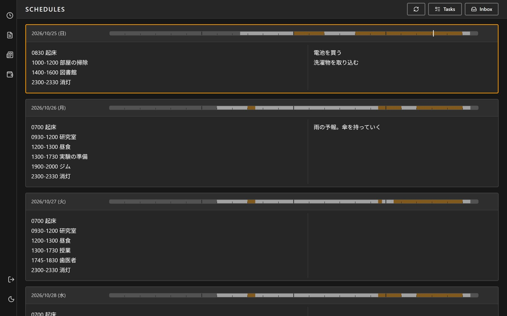
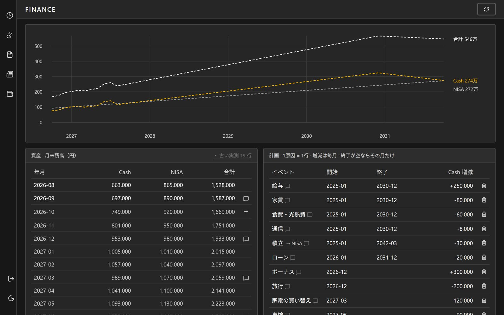

# monocore

日々変化する自分の情報（予定・メモ・天気・ニュースなど）を一か所で管理するための、個人用の Web アプリです。



## 機能

| 画面 | できること |
|---|---|
| `/schedules` | 予定を行テキストで書く。日ごとの自由メモ欄。予定から睡眠・予定のある時間・自由時間を割り出し、日ごとに3色の帯で見せる |
| Tasks（モーダル） | 進行中のプロジェクトごとの次のタスクを、4枚のカードでその場で書き換える |
| Inbox（パネル） | スマホからでも書き込める受け皿。思いついたことをとりあえず放り込む |
| `/weather` | 1時間ごとの天気（今から明日の終わりまで）と14日間の予報 |
| `/news` | RSS で集めた記事を、ソース別に新しい順で読む |
| `/finance` | 家計の見通し |



## 設計で気をつけたこと

- **装飾を削り、情報密度と操作の速さを優先**する。装飾アニメーションと影は使わず、配色はニュートラルとアンバーだけ。編集はページ内でその場で行う
- **2台の端末で同時に開いても上書きしない**：予定を日単位で版管理している
- **天気は API キー不要の Open-Meteo をブラウザから直接取る**：DB もジョブも持たない
- 睡眠・自由時間の数え方はプロパティベーステスト（fast-check）で検査している

## 動かす

**必要なもの**：Node.js、Docker（ローカルの Supabase 用）

```bash
git clone https://github.com/morikawa976321/monocore.git
cd monocore
npm install
npx supabase start          # ローカルの Supabase を起動し、supabase/migrations を適用
cp .env.example .env.local  # 起動時に表示される URL と公開キーを書き込む
npm run dev                 # http://localhost:3000
```

ローカルの Supabase に繋いでいる間は、開発用ユーザーで自動的にログインします。

`.env.local` の主な変数：

| 変数 | 内容 |
|---|---|
| `NEXT_PUBLIC_SUPABASE_URL` / `NEXT_PUBLIC_SUPABASE_PUBLISHABLE_KEY` | 必須。Supabase の接続先 |
| `WEATHER_NAME` / `WEATHER_LATITUDE` / `WEATHER_LONGITUDE` | 任意。天気の地点（未設定なら東京駅）。サーバーでだけ読む |

**ニュースの収集**は `scraper/`（Python）が行います。手元の PC で定期実行する前提で、Windows のタスクスケジューラに登録するスクリプトがあります（`scraper/register-task.ps1`）。

## 技術構成

| 層 | 使っているもの |
|---|---|
| フロントエンド | Next.js 16（App Router）、React 19、TypeScript、Tailwind CSS v4 |
| バックエンド | Supabase（Auth のメールワンタイムログイン、Postgres、RLS）、マイグレーション 26 本 |
| 収集 | Python（feedparser）|
| テスト | Vitest、fast-check、pytest |

```bash
npm test        # Vitest のあと scraper の pytest
npm run lint
```

## 状態

自分一人が毎日使うために作っているアプリです。Tasks の枠の名前など、作者の使い方に合わせた部分がそのまま入っています。

## 文書

- [docs/DEVELOPMENT.md](docs/DEVELOPMENT.md) — データの書き込み規約、マイグレーションの適用、本番データのバックアップ
- [docs/design.md](docs/design.md) — 実装が守る設計上の制約

## ライセンス

[MIT](LICENSE)
